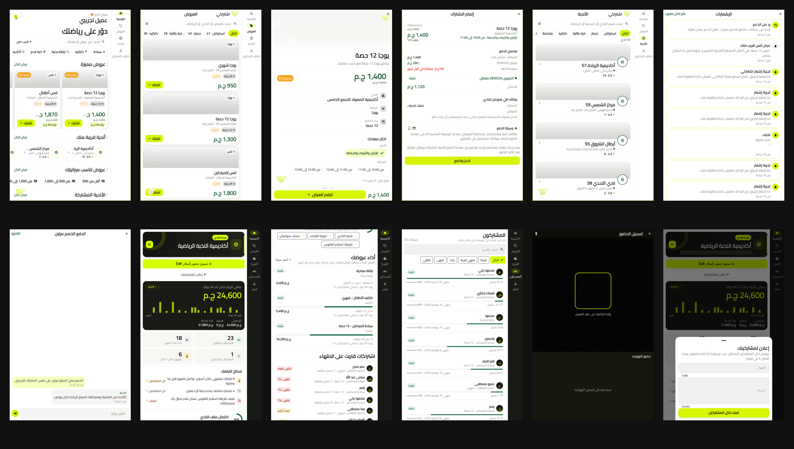

# اشتراكي: حزمة التسويق للأندية

كل اللي محتاجه عشان نعمل فيديو قوي للأندية (بالمصري) من تطبيق اشتراكي الحقيقي.
الصور كلها لقطات حقيقية من التطبيق، على **بيانات تجريبية** (أسماء وأرقام وإيرادات مش حقيقية).

## 1. اشتراكي في جملة
تطبيق بيجمع أندية الرياضة والاشتراكات في مكان واحد. العضو بيدوّر ويحجز ويدفع من الموبايل،
والنادي بيشوف إيراده ومشتركينه ويسجّل الحضور بـ QR ويبعت إعلانات لمشتركينه من لوحة واحدة.

الهوية: أسود وليموني `#D6FF00`، ولوجو الصفّارة. النغمة المميزة للتطبيق (تك تك تيك تيك) في `audio/`.

## 2. الشاشات (للفيديو)

| الملف | الشاشة | بتتكلم مع |
|---|---|---|
| `clean/club-home.png` | لوحة النادي: صافي الإيراد 30 يوم، مشتركين نشطين، "محتاج انتباهك" | صاحب النادي |
| `clean/club-home-2.png` | أداء كل عرض، واشتراكات قربت تخلص | صاحب النادي |
| `clean/club-subscribers.png` | كل مشتركين النادي بفلاتر وبحث | صاحب النادي |
| `clean/club-scanner.png` | تسجيل الحضور بالـ QR | صاحب النادي |
| `clean/club-announce.png` | إعلان لكل المشتركين النشطين | صاحب النادي |
| `clean/home.png` | الرئيسية: عروض مميزة وأندية قريبة | العضو |
| `clean/offers-list.png` | كل العروض | العضو |
| `clean/offer-details.png` | تفاصيل العرض واختيار المعاد | العضو |
| `clean/booking-coupon.png` | الدفع وكوبون الخصم | العضو |
| `clean/clubs.png` | الأندية القريبة | العضو |
| `clean/notifications.png` | الإشعارات | العضو |
| `clean/support-chat.png` | الدعم جوه التطبيق | العضو |

- `clean/`: من غير شريط الحالة وأزرار النظام، ومن غير أي إيميل.
- `framed/`: نفس الشاشات على خلفية ليموني (`-lime`) أو سودا (`-dark`) بحواف مدوّرة وظل.
- `screens/`: اللقطات الأصلية كما خرجت من التاب (فيها شريط الحالة).
- `brand/`: اللوجو والصفّارة. `audio/`: نغمة الإشعار.
- لو عايز تعيد التجهيز: `python build_kit.py` (محتاج Pillow).

**مهم:** الأرقام اللي ظاهرة (24,600 ج.م و242% و23 مشترك...) تجريبية. حط عليها "بيانات تجريبية" أو
استبدلها بأرقام حقيقية لما تتوفر. ما تذكرش في الفيديو نسب نمو أو أرباح كوعد.

## 3. الفكرة الكبيرة: "تك تك تك"

**الرؤية:** صاحب النادي مش بيدوّر على تطبيق. بيدوّر على **الساعة الفاضية** تتملي. كل ساعة فاضية
في الحمام أو الجيم أو الملعب فلوس بتروح. اشتراكي بيحوّل الساعة الفاضية لـ "تك".

**الحركة:** نغمة إشعار اشتراكي هي صوت الشعار. صوتها "تك تك" زي عقرب الساعة، ومعناها في الفيديو:
**اشتراك جديد دخل**. أول ما حد يسمع "تك تك" يفتكر الصفّارة والنادي المليان.

**الشعار:** *"الصفّارة بتملّي النادي."*

### الفيديو الأساسي (35 ثانية، رأسي 9:16)

1. **0 إلى 3 ث (الخطّاف):** شاشة سودا. صوت عقرب ساعة بطيء "تك... تك...". نادي فاضي الساعة 4 العصر،
   الحمام ساكن. كابتن واقف بالصفّارة بيبص في ساعته.
   - نص على الشاشة: **"الساعة 4. الحمام فاضي."**
   - تعليق: "كابتن، الساعة 4 والحمام فاضي؟ فلوسك بتتفرج على نفسها."
2. **3 إلى 8 ث (التحوّل):** الكابتن بينفخ في الصفّارة. الصفّارة بتتحوّل للوجو ليموني. ولأول مرة يتسمع
   **"تك تك"** سريع.
3. **8 إلى 18 ث (التك تك):** كل "تك" = موبايل في مكان مختلف في القاهرة (ميكروباص، كافيه، سرير، مكتب).
   شخص يضغط "اشترك" (`offer-details`, `booking-coupon`). وفي الحمام كل "تك" يظهر سبّاح جديد في مسار.
   السرعة بتزيد: تك، تك تك، تك تك تك. الحمام بيتملي.
4. **18 إلى 28 ث (الدليل):** قطع سريع على لوحة صاحب النادي (`club-home`): الأعمدة بتطلع، المشتركين،
   "محتاج انتباهك". بعدها 3 لقطات سريعة: مسح QR على الباب (`club-scanner`)، إعلان لكل المشتركين
   (`club-announce`)، وتنبيه "6 اشتراكات هتخلص" (`club-home`).
5. **28 إلى 35 ث (النهاية):** صاحب النادي على مكتبه، موبايله بيعمل "تك تك تك" من غير توقف. بيبصله
   ويقول مبتسم: **"ارحمني بقى!"** يكتم الصوت. لوجو الصفّارة.
   - نص: **"الصفّارة بتملّي النادي."**
   - دعوة: **"نزّل اشتراكي وسجّل ناديك."**

### الفكرة اللي برّه الصندوق: #أول_تك
كل نادي بيصوّر **"أول تك"**: اللحظة اللي موبايله بيرن لأول اشتراك جاي من التطبيق (ريلز 10 ثواني،
رد فعل حقيقي). النادي اللي بينشر بيتعمله مكان مميّز في التطبيق (مقترح، لازم نقرره). كده كل نادي
بيعمل لنفسه إعلان، والـ"تك تك" بقى صوت مشهور بيعرّف بالتطبيق.

### ليه النادي يفتح التطبيق كل يوم؟ (حاجات حقيقية في المنتج)
- **الحضور:** QR على الباب كل حصة (الشاشة موجودة).
- **"محتاج انتباهك":** مين هيخلّص اشتراكه الأسبوع ده ومين فاضله حصة أو اتنين.
- **الإعلانات:** يبعت لمشتركينه عرض أو تنبيه في ثواني.
- **قائمة الانتظار:** لو مكان فضي، اللي مستني بيوصله إشعار لوحده.
- **الإيراد:** الرسم اليومي بيخلّيه يبص كل صباح.

## 4. نسخ إضافية
- **15 ث:** المشاهد 1 و2 و3 و5 بس.
- **6 ث (بامبر):** "تك تك تك" + الحمام بيتملي + لوجو.
- **سوشيال ثابت:** `framed/club-home-lime.png` + سطر: "شوف إيرادك كل يوم في شاشة واحدة."
- **للعضو (مش للنادي):** "اشتراكك قرّب يخلص؟ تك. تمرينك بعد ساعة؟ تك."

## 5. نبرة الكلام
مصري، قصير، فيه ابتسامة. جمل زي "ارحمني بقى" و"الحمام فاضي". من غير شعارات كبيرة ولا وعود أرباح.
الأرقام والأسعار بس لما تكون حقيقية ومتأكد منها.

## 6. ما تعملوش
- ما تعرضش أسماء أو أرقام تليفونات حقيقية. الأسماء في الشاشات تجريبية.
- ما تذكرش نسبة عمولة أو سعر للنادي في الفيديو قبل ما نقرره.
- ما تقولش "أول تطبيق" أو "رقم 1" من غير دليل.
- ما تقولش إن التطبيق على الأيفون. النسخة الحالية أندرويد بس.

## 7. بريف جاهز للصق في LM Arena
شوف `PROMPT_LMARENA.md`.
